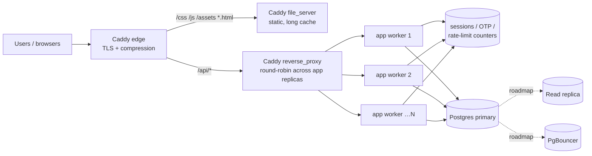

# Scaling the BCCI portal

This document covers how the portal behaves under load, the changes that make
it scale horizontally, and the next levers to pull. It is written for the
single-VPS Docker Compose deployment in `docker-compose.yml` / `deploy/`.

## 1. Target and capacity math

Design point: ~1,000,000 daily active users on a read-heavy, mostly-static site.

| Quantity | Value | Basis |
|---|---|---|
| Requests / day | ~5,000,000 | 1M DAU × ~5 requests each |
| Average RPS | ~58 | 5M / 86,400 s |
| Peak RPS | ~175–290 | 3–5× average (event/announcement spikes) |
| Read : write | ~90 : 10 | browsing + verification vs. applications/registrations |
| Peak reads / writes | ~260 / ~29 RPS | |

Where those requests land:

- **~90% is static** (HTML/CSS/JS/images). Once served by a cache (Caddy, or a
  CDN in front), these never reach Node or Postgres.
- **API traffic** after that offload is ~58 RPS average, ~290 RPS at peak.

Per-component headroom at peak (~290 RPS API):

- **App tier** — one Node worker handles roughly 1–3k simple JSON req/s; the
  image runs 4 workers (`WEB_CONCURRENCY=4`), so ~4–12k req/s of headroom.
- **Database** — ~290 RPS × ~2 queries ≈ **~600 qps**. With 4 workers ×
  `PG_POOL_MAX=10` = 40 pooled connections and 1–3 ms/query, Postgres 17 on the
  same box comfortably serves this. The pool, not the query engine, is the first
  thing to tune as workers grow.
- **Static** — off the app entirely; bounded by Caddy/disk or the CDN.

**What crashes first at 10× today?** (pre-change baseline)
1. Static files streamed through Node — every image/JS byte ties up the app's
   event loop and libuv threadpool. *Fixed: Caddy now serves static directly.*
2. One Node process on one core. *Fixed: cluster mode uses all cores.*
3. Unbounded storage calls + a 10-connection pool pin the request path when
   Postgres/Redis hiccup. *Fixed: per-call timeouts + pool/statement timeouts.*

## 2. Architecture



The application tier is **stateless**: sessions, OTP codes and rate-limit
counters live in the shared store (`kv`), not in the process, so any worker can
answer any request. That is what makes both the in-container cluster and adding
whole replicas safe.

## 3. What changed (implemented)

Code:

- **`server.js`** — `CLUSTER=1` forks one worker per `WEB_CONCURRENCY` (bounded,
  default = CPU count) and replaces any worker that dies; each worker shares the
  listening socket. Per-request `X-Request-Id` + a `REQUEST_TIMEOUT_MS` ceiling
  so a hung handler can't pin a worker; optional structured JSON access logs
  (`LOG_JSON=1`) with `durationMs` for p95/p99; keep-alive tuned for the proxy.
- **`api/_lib/keys.js`** — every storage call is now bounded by
  `STORAGE_TIMEOUT_MS`, so a slow Upstash/Postgres hop fails fast instead of
  holding a request (and a pool connection) open through the whole retry chain.
- **`api/_lib/postgres.js`** — pool hardened: `connectionTimeoutMillis`,
  `statement_timeout`/`query_timeout`, `keepAlive`, `PG_POOL_MAX` (default 20);
  added the `(status, submitted_at DESC)` index for the admin list.
- **`api/health.js`** — `GET /api/health?probe=live` is a dependency-free
  **liveness** probe (200 while the process is up); `/api/health` stays the
  **readiness** probe (checks DB/Redis). Use liveness for "restart me" and
  readiness for "take me out of rotation".

Deployment:

- **`deploy/Caddyfile`** — static requests are served from disk by Caddy with
  `immutable`/1-week cache headers and `zstd gzip`; only `/api/*` is proxied to
  the app. This is the largest single capacity gain.
- **`docker-compose.yml`** — Caddy mounts only the static paths (never the repo
  root, so `.env` stays out of the web tier); app runs clustered with a memory
  cap, request drain (`stop_grace_period`), and `start_period`; Postgres tuned
  with `max_connections=200` + modest memory settings and `shm_size`.

## 4. Scaling out (runbook)

Everything below is env/compose only — no code changes.

**Add app capacity (more cores in one container):**

```bash
# in .env
WEB_CONCURRENCY=8          # keep WEB_CONCURRENCY x PG_POOL_MAX < max_connections
docker compose up -d --build app
```

**Add whole replicas behind Caddy** (multiple containers, one box or many):

```bash
docker compose up -d --scale app=3
```

> The `ports: 127.0.0.1:3000:3000` mapping on `app` must be removed for
> `--scale` to work (a fixed host port can't be bound twice). Caddy reaches
> replicas over the compose network at `app:3000` and round-robins. The
> `deploy/` smoke test then needs to check health through Caddy (or
> `docker compose exec`).

**Front the database with PgBouncer** once `replicas × PG_POOL_MAX` approaches
`max_connections`: add a PgBouncer service in transaction pooling mode and point
`DATABASE_URL` at it, keeping the app pool small.

**Read replicas** for the read-heavy admin/report paths (`listApplications`,
stats) once Postgres CPU or IO is the bottleneck; route those queries to a
replica and keep writes on the primary.

**Put a CDN in front** (Cloudflare et al.) for `/assets`, `/css`, `/js`. Caddy
already sets cache headers; the CDN turns ~90% of traffic into edge hits and
also absorbs spikes/DDoS before they reach the box.

**Move email off the request path.** Today notifications are sent inline
(deadline-bounded by `sendEmailWithin`). At scale, enqueue jobs in the `kv`
store and process them in a background worker with exponential-backoff retries
and a dead-letter queue.

## 5. Observability

- `LOG_JSON=1` emits one JSON line per request (`requestId`, `method`, `path`,
  `status`, `durationMs`) — feed it to your log stack and chart **p95/p99**, not
  the average. `X-Request-Id` is echoed to the client for correlating a report
  with the logs.
- `/api/health` (readiness) and `/api/health?probe=live` (liveness) for probes.
- `log_min_duration_statement=500` in Postgres surfaces slow queries.

## 6. Load testing

Before a big push, verify the numbers on real hardware:

```bash
# k6 (or ab/hey). Point at the API + a static asset mix.
k6 run --vus 300 --duration 2m loadtest.js   # ~300 concurrent users
```

Watch: app CPU per worker, Postgres `pg_stat_activity` (active vs. idle
connections), pool wait time, and p99 latency from the JSON logs. If p99 climbs
while CPU is low, it's the pool or a slow query — not the app tier.

## 7. Environment reference

| Variable | Default | Purpose |
|---|---|---|
| `CLUSTER` | `0` | `1` forks a worker per `WEB_CONCURRENCY` |
| `WEB_CONCURRENCY` | CPU count | workers (bounded in compose) |
| `PG_POOL_MAX` | `20` | Postgres pool size **per worker** |
| `PG_CONNECT_TIMEOUT_MS` | `5000` | fail fast when the pool is saturated |
| `PG_STATEMENT_TIMEOUT_MS` | `10000` | per-query ceiling |
| `STORAGE_TIMEOUT_MS` | `8000` | per-attempt storage ceiling |
| `REQUEST_TIMEOUT_MS` | `15000` | whole-request ceiling |
| `LOG_JSON` | `0` | structured access logs |
| `KEEP_ALIVE_TIMEOUT_MS` | `65000` | HTTP keep-alive behind the proxy |
